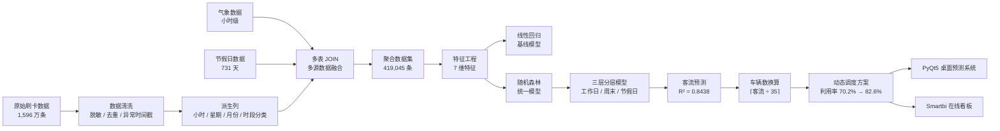
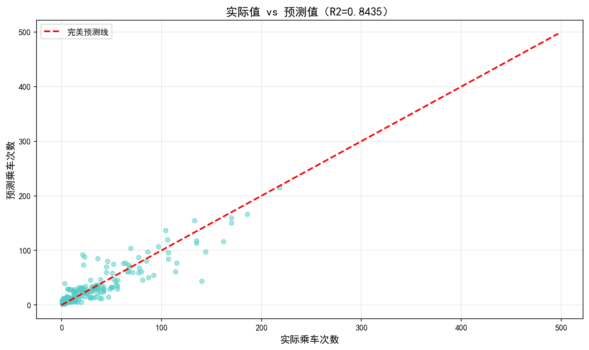
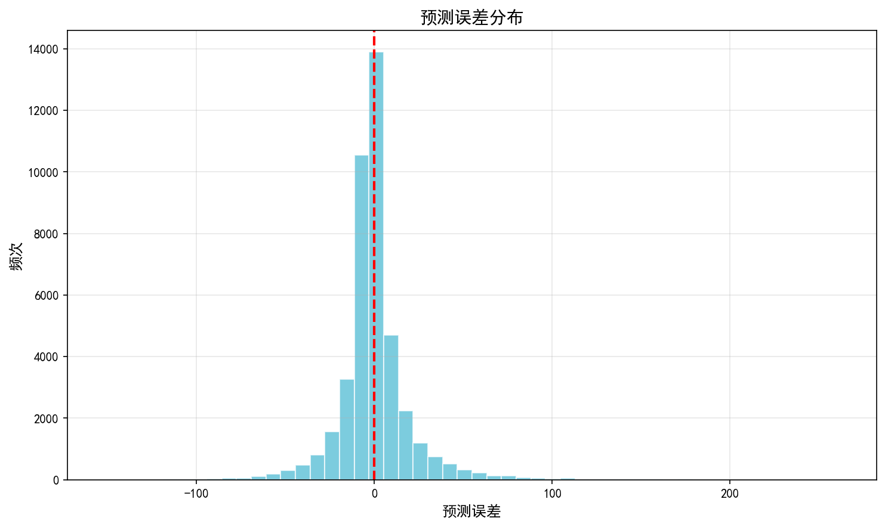
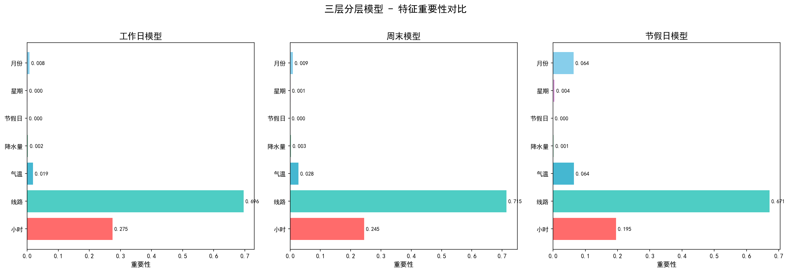
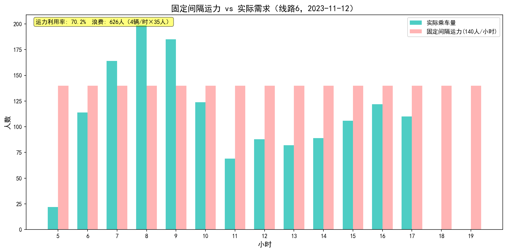
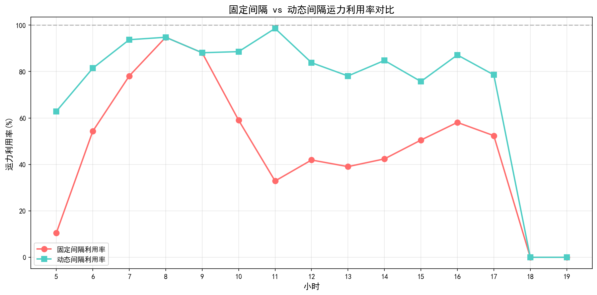
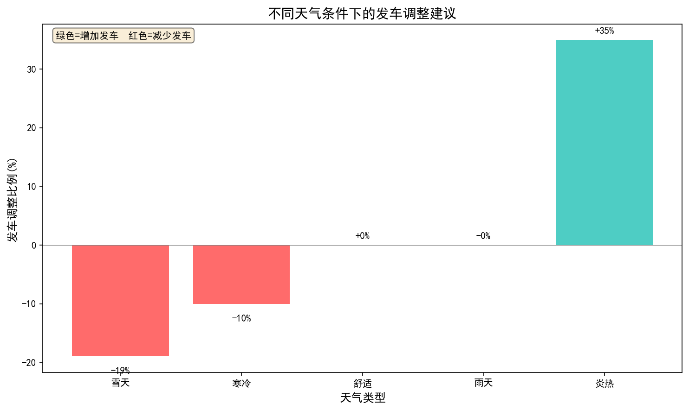

# 城市公交高峰客流运力调度决策分析平台

> 基于 **1,596 万条**真实公交刷卡记录，融合天气与节假日维度，用随机森林预测分时客流，把「固定时刻表发车」改造为「按需动态调度」——**运力利用率从 70.2% 提升至 82.6%**。

[](https://www.python.org/)
[](https://scikit-learn.org/)
[](https://www.smartbi.com.cn/)
[](https://pypi.org/project/PyQt5/)

---

## 一、项目速览

| 项目 | 内容 |
| :--- | :--- |
| **赛题** | 2026 年「挑战杯」· Smartbi AI 驱动的数据创新平台研究 · 揭榜挂帅企业命题 |
| **命题方** | 思迈特软件（Smartbi） |
| **参赛形式** | 团队参赛 |
| **我的角色** |  主要负责人 整体项目的设计与实现 |
| **数据规模** | 1,596 万条刷卡记录 · 54 条线路 · 295 辆车 · 24 个月（2023.01–2024.12） |
| **核心交付** | 客流预测模型（R²=0.8438）+ Smartbi ETL 管道 + 在线分析看板 + 动态调度方案 + PyQt5 预测系统 |

**一句话概括业务价值**：让公交公司知道「明天早高峰该在几号线发几辆车」，而不是每天按同一张时刻表发车。

---

## 二、要解决的业务问题

龙口市（山东省县级市）公交长期采用**固定时刻表**调度，由此产生三个可量化的问题：

| 问题 | 表现 | 代价 |
| :--- | :--- | :--- |
| **供需错配** | 以线路 6 为例，全天运力利用率仅 **70.2%**，18 时客流低谷仍在投放固定运力 | 近 30% 运力空驶 |
| **配车失衡** | 11–30 号线路配车数与客流量脱钩（16 号线客流 35 万却配 45 辆车）；31–66 号低客流线路普遍冗余 | 干线挤、支线空 |
| **外部因素失明** | 天气、节假日对客流的影响从未进入调度决策 | 高温天运力不足、雪天运力过剩 |

**目标**：用数据回答三个问题——高峰期在哪、客流有多少、该配几辆车。

---

## 三、数据构成

| 数据源 | 来源 | 时间范围 | 数据量 |
| :--- | :--- | :--- | :--- |
| 公交刷卡记录 | 龙口市公交公司（已脱敏） | 2023.01–2024.12 | 15,965,997 条 |
| 气象数据（小时级） | 气象数据接口 | 同上 | 17,568 条 |
| 法定节假日 | 国务院公告 | 同上 | 731 天 |

清洗掉卡号、身份证等隐私字段后保留约 1,596 万条记录，按 **「日期 × 小时 × 线路」** 三维聚合，得到训练用数据集 **419,045 条 × 13 列**（模型使用其中 7 个特征）。

> 原始数据因体积（1.2 GB）与授权限制未入库，仓库内提供聚合后数据集与 3,000 行抽样样例，详见 [`data/README.md`](data/README.md)。

---

## 四、技术方案



### 4.1 为什么用分层模型

客流在工作日、周末、节假日呈现**完全不同**的分布形态。直接混训会让模型在少数类（节假日样本仅占 7%）上表现塌陷。因此按日期类型拆成三个子模型独立训练：

| 子模型 | 筛选条件 | 样本量 | R² |
| :--- | :--- | ---: | ---: |
| 工作日 | `is_holiday=0` 且 `weekday<5` | 281,117 | 0.8412 |
| 周末 | `is_holiday=0` 且 `weekday≥5` | 108,667 | 0.8346 |
| 节假日 | `is_holiday=1` | 29,261 | 0.7986 |
| **分层整体** | — | **419,045** | **0.8438** |

预测时按 `is_holiday` / `weekday` 自动路由到对应子模型。

### 4.2 抑制过拟合

随机森林极易记住噪声。采用三道约束：`max_depth=10`（限制树深）、`min_samples_leaf=5`（叶子最少样本）、`n_estimators=100`。数据按 **8:1:1** 划分训练/验证/测试，训练集与验证集 R² 差值仅 **-0.0006**，确认无过拟合。

### 4.3 从「客流」到「车辆数」

预测出客流只是中间结果，业务要的是发车数。以 8 米大巴荷载 54 人、实测单车早高峰载客约 30 人（荷载 56%）为依据，取 **35 人/车** 作为基准（介于实际峰值与理论荷载之间，约荷载 65%），按 `⌈客流 ÷ 35⌉` 向上取整，确保运力永不低于需求。该换算模型的 R² 达 **0.9997**。

---

## 五、核心结果

### 5.1 预测精度显著优于基线

| 模型 | R² | MAE（人次） | 说明 |
| :--- | ---: | ---: | :--- |
| 线性回归 | 0.1548 | 32.65 | 几乎无预测能力，证明客流与特征高度非线性 |
| 随机森林（统一） | 0.8332 | 12.48 | 已可用，但在节假日样本上偏弱 |
| **随机森林（三层分层）** | **0.8438** | **12.12** | **最终采用** |



误差呈以 0 为中心的正态分布，绝大部分落在 ±5 人次内，**不存在系统性高估或低估**：



### 5.2 特征重要性：线路和时段决定一切

`LINECODE`（0.7047）+ `hour`（0.2619）合计解释 **96% 以上** 的客流变异，气温位列第三。这与业务逻辑高度自洽：**线路决定服务人口基数，时段决定出行需求分布，气温影响出行方式选择**。



### 5.3 调度优化：利用率 70.2% → 82.6%

以线路 6 为试点，固定间隔模式下运力与实际需求严重脱节：



改为按预测客流动态配置后，各时段运力贴近真实需求，**所有时段运力 ≥ 实际客流**（服务不降级的前提下），全天运力利用率提升至 **82.6%**，节省运力约 **15%**：



### 5.4 天气联动调度规则

将天气纳入调度决策，输出可直接执行的调整系数：

| 天气类型 | 客流变化 | 发车调整建议 |
| :--- | ---: | :--- |
| 炎热（≥30℃ 无降水） | +35.2% | **增发 35%** |
| 舒适（5–30℃ 无降水） | 基准 | 维持 |
| 雨天（>0℃ 有降水） | -0.3% | 维持 |
| 寒冷（<5℃ 无降水） | -10.2% | 减发 10% |
| 雪天（≤0℃ 有降水） | -19.2% | 减发 19% |

> 反直觉发现：**雨天客流几乎不受影响（-0.3%）**，而高温天客流暴涨 35%。原因在于龙口市两年降水量最大值仅 0.0074 mm/h，从未出现中雨以上天气——这也说明「降雨强度影响客流」在本数据集上无法得出有效结论，报告中对此作了明确的数据局限性说明，而非强行凑结论。



---

## 六、仓库结构

```
bus-dispatch-analytics/
├── src/                        # 分析与建模脚本（按执行顺序编号）
│   ├── config.py                   # 统一路径与全局参数（数据/模型/图表目录）
│   ├── 01_data_preprocessing.py    # 清洗 + 聚合 + 多源关联（需原始流水）
│   ├── 02_model_training.py        # 线性回归 / 随机森林基线
│   ├── 02e_stratified_model.py     # 三层分层模型（最终采用）
│   ├── 03_visualization.py         # 分析图表生成
│   ├── 04_dispatch_optimization.py # 调度优化计算
│   ├── 05_prediction_gui.py        # PyQt5 预测调度桌面系统
│   ├── run_all.py                  # 一键跑通全部流程
│   └── tools/
│       └── split_large_csv.py      # 超大 CSV 流式切分工具（处理 1.2 GB 原始流水）
├── figures/                    # 结果图表（README 中展示）
│   └── dispatch/               # 调度优化专项图表
├── models/                     # 训练产物（.gitignore 排除，脚本自动生成）
├── dashboard/                  # Smartbi 看板复现指南（HTML 静态页）
├── docs/
│   ├── 代码说明.md              # 各脚本详细说明与执行流程
│   ├── 整合说明.md              # 从 2.5 GB 交付包到本仓库的取舍记录
│   └── reports/                # 完整分析报告、答辩演示
└── data/
    ├── aggregated_data_full.csv.gz  # 聚合数据集（419,045 条 × 13 列）
    ├── sample_aggregated.csv        # 3,000 行抽样，便于快速查看
    ├── weather.csv                  # 小时级气象数据
    ├── holidays.csv                 # 法定节假日
    └── raw/                         # 原始流水存放位置（需自备，未入库）
```

---

## 七、复现方式

```bash
# 1. 安装依赖
pip install -r requirements.txt

# 2. 一键跑通：基线模型 → 分层模型 → 全部图表
python src/run_all.py

# 3. （可选）启动图形化预测系统，需 PyQt5
python src/05_prediction_gui.py
```

也可分步执行，观察每一步输出：

```bash
python src/02_model_training.py         # 线性回归 vs 随机森林，含过拟合检测
python src/02e_stratified_model.py      # 三层分层模型，输出各层 R² 对比
python src/03_visualization.py          # → figures/*.png
python src/04_dispatch_optimization.py  # → figures/dispatch/*.png
```

> **可复现性**：上述流程已实测跑通，输出与原报告一致——线性回归 R²=0.1548、
> 随机森林 R²=0.8332（训练/验证差 -0.0006）、三层分层 R²=0.8438 / MAE=12.12；
> 天气影响比例（炎热 +35.2%、雪天 -19.2%、寒冷 -10.2%、雨天 -0.3%）亦与原报告吻合。

> **关于路径**：所有脚本通过 [`src/config.py`](src/config.py) 统一定位数据、模型与图片目录，
> 不依赖当前工作目录，因此可以在任意位置运行。聚合数据以 gzip 存储，pandas 可直接读取，
> 无需手动解压。若要从原始流水重跑 ETL：把原始 CSV 放入 `data/raw/`，执行
> `python src/run_all.py --with-etl`。

---

## 八、这个项目让我练到了什么

- **真实脏数据工程**：1,596 万条记录的清洗、去重、时间戳异常过滤，以及在内存受限下用分页脚本处理超大 CSV。
- **模型选型的判断力**：先用线性回归确立非线性基线（R²=0.15），再用随机森林验证，最后用分层策略解决少数类塌陷——每一步都有对比数据支撑，而不是「直接上随机森林」。
- **从模型指标到业务指标**：R² 高不等于有用，所以额外构建了「客流 → 车辆数」的换算层，并用运力利用率（70.2%→82.6%）衡量真实收益。
- **对结论保持克制**：发现降水量数据不足以支撑「降雨强度」结论时，明确写进局限性说明，而不是用不足的数据强行论证。

---

## 九、文档

| 文档 | 说明 |
| :--- | :--- |
| [`docs/代码说明.md`](docs/代码说明.md) | 六个脚本的输入输出、执行依赖、模型指标 |
| [`docs/整合说明.md`](docs/整合说明.md) | 从 2.5 GB 竞赛交付包到本仓库的文件取舍记录 |
| [`docs/reports/项目报告.docx`](docs/reports/) | 完整数据分析报告（含全部 35 张图表） |
| [`docs/reports/答辩演示.pptx`](docs/reports/) | 答辩演示文稿 |
| [`dashboard/index.html`](dashboard/index.html) | Smartbi 看板搭建与操作指南 |

---

*数据已脱敏处理，不包含任何乘客个人身份信息。*
