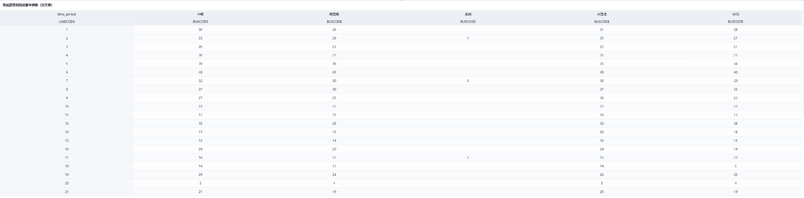
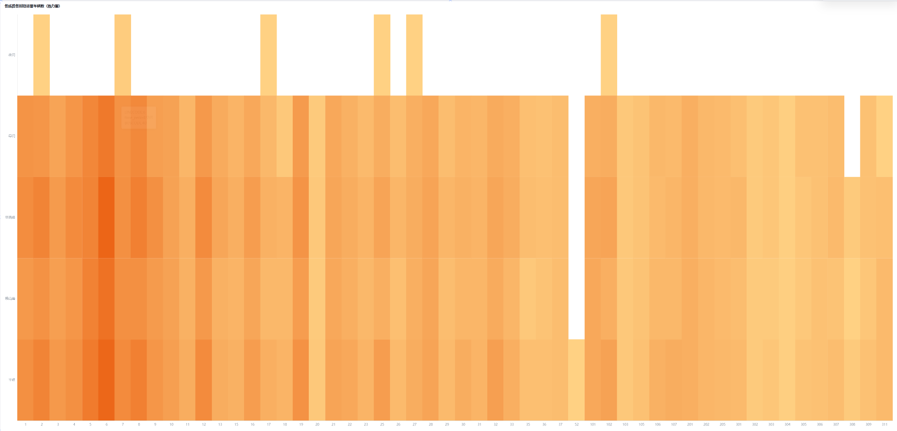
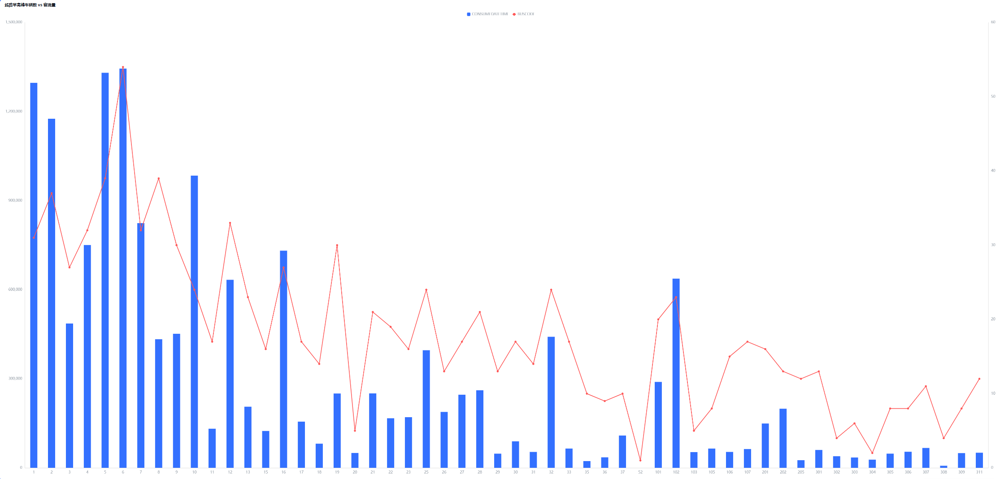
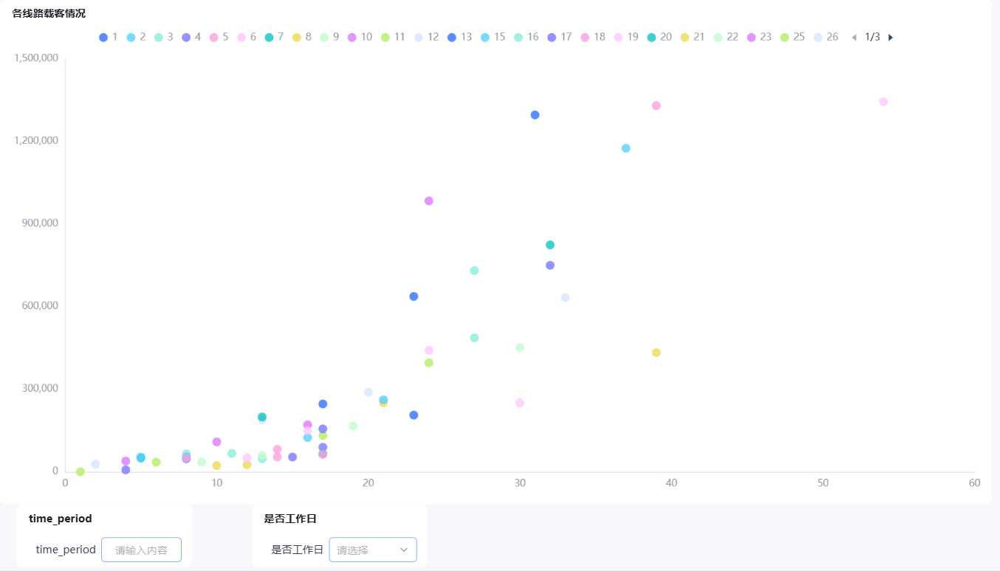
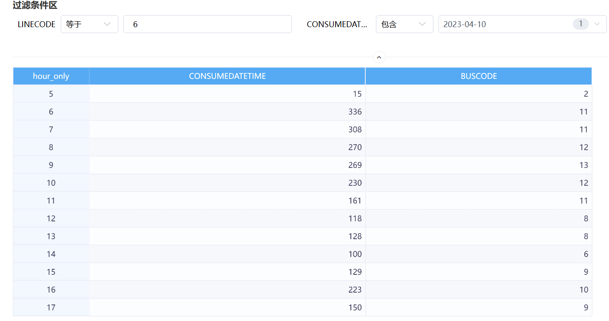

# Smartbi 公交客流仪表盘操作说明

---

## 目录

1. [看板总览](#1-看板总览)
2. [看板1：公交客流态势总览](#2-看板1公交客流态势总览)
3. [看板2：高峰时段识别](#3-看板2高峰时段识别)
4. [看板3：调度现状分析](#4-看板3调度现状分析)
5. [看板4：多维度影响因素分析](#5-看板4多维度影响因素分析)

---

## 1. 看板总览

本项目在 Smartbi 平台上搭建了**4个看板**，覆盖从客流宏观态势到微观调度优化的完整分析链路。所有数据均来自三表关联后的公交刷卡数据），在 Smartbi 内通过透视分析直接聚合计算。

| 看板 | 状态 | 核心内容 | 分析维度 |
|------|------|----------|----------|
| **看板1：公交客流态势总览** | ✅ 已完成 | 总客流KPI、节假日/工作日指标卡、24月趋势图、线路分布图 | 日期 × 线路 × 客流量 |
| **看板2：高峰时段识别** | ✅ 已完成 | 高峰时段分布柱形图、24小时雷达图、线路热力图 | 小时 × 线路 × 客流量 |
| **看板3：调度现状分析** | ✅ 已完成 | 运营车辆数交叉表/热力图、车辆vs客流双轴图、载客率散点图/明细表 | 线路 × 时段 × 车辆数 × 客流量 |
| **看板4：多维度影响因素分析** | ✅ 已完成 | 温度24h曲线、温度/天气/降雨/早7时对比柱形图 | 天气 × 温度 × 降雨 × 小时 × 客流量 |

---

## 2. 看板1：公交客流态势总览

> **目标**：展示整体客流情况，快速了解关键指标

### 2.1 组件总览

| 序号 | 组件 | 类型 | 说明 |
|------|------|------|------|
| 1-1 | 客流量总数KPI | 指标卡 | 两年总刷卡次数 |
| 1-2 | 节假日指标卡 | 指标卡 | 节假日 vs 非节假日客流对比 |
| 1-3 | 是否工作日指标卡 | 指标卡 | 工作日 vs 非工作日客流对比 |
| 1-4 | KPI分析（24月趋势） | 折线图 | 2023-01至2024-12月客流趋势 |
| 1-5 | 线路分布图 | 柱状图 | 各线路客流总量排名 |

### 2.2 客流量总数KPI

*图1-1：客流量总数KPI指标卡*

**透视分析设置：**

- 【值】→ `CONSUMEDATETIME`（计数）

该指标卡显示两年数据的**总刷卡次数为15,965,997次**，日均约2.2万次。这是整个仪表盘的核心基准指标，后续所有分析均围绕该总量展开。

### 2.3 节假日指标卡

*图1-2：节假日指标卡*

**透视分析设置：**

- 【行】→ `is_holiday`（是否节假日）
- 【值】→ `CONSUMEDATETIME`（计数）

| 类别 | 客流量 | 占比 |
|------|--------|------|
| 非节假日 | 14,981,201 | 93.8% |
| 节假日 | 984,796 | 6.2% |

> ⚠️ **注意**：节假日天数远少于非节假日天数，总量对比不等于日均对比。非节假日日均客流量约2.3万次，节假日日均约1.1万次，节假日日均客流约为非节假日的47%。

### 2.4 是否工作日指标卡

*图1-3：是否工作日指标卡*

**透视分析设置：**

- 【行】→ `is_workday`（是否工作日）
- 【值】→ `CONSUMEDATETIME`（计数）

| 类别 | 客流量 | 占比 |
|------|--------|------|
| 工作日 | 11,075,925 | 69.4% |
| 非工作日 | 4,890,072 | 30.6% |

工作日客流总量约为非工作日的2.26倍，扣除天数差异后，工作日日均客流约为非工作日的1.4倍，体现了通勤出行对公交系统的核心驱动作用。

### 2.5 KPI分析（24月趋势）

*图1-4：2023年1月至2024年12月月客流趋势*

**透视分析设置：**

- 【X轴】→ `CONSUMEDATETIME`（按月）
- 【Y轴】→ `CONSUMEDATETIME`（计数）

该折线图展示了两年的月客流变化趋势。数据呈现明显的**季节性波动**：2023年初约28万起步，经历快速增长后稳定在60-65万区间。2023年11月出现异常峰值（约79万），随后2023年12月和2024年2月出现两次低谷（约47万），可能与春节假期效应叠加冬季天气影响有关。2024年3月后客流稳定在83-86万水平，较2023年同期提升了约35%。

### 2.6 线路分布图

*图1-5：各线路客流总量分布*

**透视分析设置：**

- 【X轴】→ `LINECODE`（线路编号）
- 【Y轴】→ `CONSUMEDATETIME`（计数）

该柱状图展示了50+条线路的客流总量分布。线路间客流差异悬殊：**线路5和线路6客流最高**（约135万），线路1和线路2紧随其后（约120万），而300系列线路客流普遍偏低（多数低于20万）。线路52客流接近零，可能为数据缺失或特殊线路。整体呈现**长尾分布**特征——少数线路承担了大部分客流，为运力分配提供了直观的优先级依据。

---

## 3. 看板2：高峰时段识别

> **目标**：识别全天高峰时段规律，分析不同线路的客流时空分布特征

### 3.1 组件总览

| 序号 | 组件 | 类型 | 说明 |
|------|------|------|------|
| 2-1 | 高峰时段分布图 | 柱形图 | 24小时客流分布，识别早晚高峰 |
| 2-2 | 某线路24小时客流 | 雷达图 | 20条系列的24小时客流形态 |
| 2-3 | 线路24小时热力图 | 热力图 | 27条线路×24小时的客流密度 |

### 3.2 高峰时段分布图

*图2-1：高峰时段分布柱形图*

**透视分析设置：**

- 【X轴】→ `hour_only`（0-23小时）
- 【Y轴】→ `CONSUMEDATETIME`（计数）

该柱形图清晰展示了全天客流分布的**单峰形态**：

| 时段 | 小时 | 客流特征 |
|------|------|----------|
| 早高峰 | 7-9时 | 峰值约215万次/小时（8时最高） |
| 次高峰 | 6时、10时 | 约140-150万次/小时 |
| 午间低谷 | 11-12时 | 约80-100万次/小时 |
| 午后平台 | 13-16时 | 稳定在92-99万次/小时 |
| 傍晚下降 | 17时 | 约81万次/小时 |
| 夜间骤降 | 18-20时 | 从18万降至接近零 |
| 深夜无运营 | 0-5时、21-23时 | 零或接近零 |

**核心发现**：早高峰（7-9时）集中了全天客流的60-65%，8时为绝对峰值。无明显晚高峰（17-18时客流仅约早高峰的38%），提示该公交系统以**早间通勤为主要服务场景**，夜间运营到19时左右基本结束。

### 3.3 某线路24小时客流（雷达图）

*图2-2：某线路24小时客流雷达图（20条系列）*

**透视分析设置：**

- 【角度轴】→ `hour_only`（0-23小时）
- 【径向轴】→ `CONSUMEDATETIME`（计数）
- 【系列】→ 20条数据系列（可能代表不同日期或不同线路）

该雷达图以极坐标形式展示24小时客流形态。20条系列的叠加虽然密集，但整体形状一致，都呈现**早高峰凸起、午间平稳、傍晚回落**的规律。图例显示1/4分页，共约80条系列，可逐页浏览不同线路的客流形态。各系列在早高峰（7-9时）的峰值幅度差异明显，反映了不同日期或线路的客流强度差异。

### 3.4 线路24小时热力图

*图2-3：线路24小时热力图*

**透视分析设置：**

- 【X轴】→ `LINECODE`（27条线路）
- 【Y轴】→ `hour_only`（5-22时，含凌晨0-1时）
- 【颜色/值】→ `CONSUMEDATETIME`（计数）

热力图通过颜色深浅（深橙=高客流，浅黄=低客流，白色=零/无数据）直观展示**27条线路×24小时的客流密度矩阵**。

**关键发现**：

- **早高峰热点集中**：线路1-11在5-10时深橙色区域最广，早高峰客流高度集中
- **线路分级明显**：线路13-36呈中等橙色，客流适中；线路52、102-309出现大量白色间隙，客流稀疏或数据缺失
- **深夜异常点**：线路25在0时、线路307在凌晨仍有个别深橙色，提示可能存在夜间专线或机场/火车站接驳线路
- **客流衰减趋势**：从左到右颜色逐渐变浅，客流从线路1-11的高峰向线路300系列递减

---

## 4. 看板3：调度现状分析

> **目标**：展示当前各线路、各时段的运营车辆分布，对比供需关系，评估调度合理性

### 4.1 组件总览

| 序号 | 组件 | 类型 | 说明 |
|------|------|------|------|
| 3-1 | 各线路各时段运营车辆数（交叉表） | 交叉表 | 行=线路，列=时段，值=车辆唯一计数 |
| 3-2 | 各线路各时段运营车辆数（热力图） | 热力图 | 颜色深浅表示车辆数多寡 |
| 3-3 | 线路早高峰车辆数 vs 客流量 | 双轴图 | 柱子=客流量，折线=车辆数 |
| 3-4 | 各线路载客情况 | 散点图 | 26条线路的车辆数×客流量分布 |
| 3-5 | 载客率分析 | 筛选表 | 单线路单日各时段车辆与客流明细 |

### 4.2 各线路各时段运营车辆数（交叉表）

*图3-1：各线路各时段运营车辆数交叉表*

**透视分析设置：**

- 【行】→ `LINECODE`（线路编号）
- 【列】→ `time_period`（早间/早高峰/平峰/晚高峰/夜间）
- 【值】→ `BUSCODE`（**唯一计数**）

> 💡 **关键操作**：点击 BUSCODE 旁的"计数"改为"唯一计数"，统计每条线路每个时段有多少辆不同的车在跑，即为当前运营车辆数。

该交叉表以表格形式精确展示每条线路在每个时段的运营车辆数。通过逐行逐列对比，可以快速识别**哪些线路在哪些时段投放了较多/较少车辆**，为后续的供需匹配分析提供数据基础。

### 4.3 各线路各时段运营车辆数（热力图）

*图3-2：各线路各时段运营车辆数热力图*

**透视分析设置：**

- 【X轴/列】→ `time_period`（时段）
- 【Y轴/行】→ `LINECODE`（线路）
- 【颜色/值】→ `BUSCODE`（唯一计数）

**颜色设置**：高车辆数→深橙色，低车辆数→浅黄/白色。建议使用条件格式按数值大小做颜色渐变。

热力图是交叉表的可视化呈现，通过颜色深浅直观展示**车辆投放的热点区域**。从左到右可观察各时段车辆投放的变化趋势：早高峰时段颜色最深（车辆最多），平峰时段颜色逐渐变浅（车辆减少），夜间时段趋于白色（车辆最少）。纵向对比可发现不同线路的车辆投放差异。

### 4.4 线路早高峰车辆数 vs 客流量

*图3-3：线路早高峰车辆数 vs 客流量双轴对比图*

**透视分析设置：**

- 【X轴】→ `LINECODE`（线路编号）
- 【左Y轴（柱子）】→ `ride_count`（计数）= 客流量
- 【右Y轴（折线）】→ `BUSCODE`（唯一计数）= 车辆数
- 【筛选器】→ `time_period = 早高峰(7-9)`

**图表类型**：双轴图（柱形+折线），蓝色柱子=客流量，红色折线=车辆数。

该图表将**供需两侧放在同一视图中对比**，是调度分析的核心图表。当柱子高而折线低时，表示客流量大但车辆少→**运力不足**；当柱子低而折线高时，表示客流量小但车辆多→**运力过剩**。理想状态是两者走势基本一致，即车辆投放与客流需求匹配。

### 4.5 各线路载客情况

*图3-4：各线路载客情况散点图*

**透视分析设置：**

- 【X轴】→ `time_period`（时段序号）
- 【Y轴】→ 客流量（计数）
- 【颜色/分类】→ `LINECODE`（26条线路，不同颜色）
- 【筛选器】→ `是否工作日`（可选）

该散点图将26条线路的客流数据按时间维度展开，不同颜色代表不同线路。从图中可以观察到：**少数线路（粉色系）在特定时段出现极高客流峰值**（超过120万），而大多数线路集中在较低客流区间（30万以下）。这揭示了线路间客流分布极不均衡的特征，提示调度资源应向高客流线路倾斜。同时，筛选器支持按工作日/非工作日切换，可进一步分析不同日期类型下的载客特征。

### 4.6 载客率分析

*图3-5：载客率分析 — 单线路单日各时段车辆与客流明细*

**透视分析设置：**

- 【行】→ `hour_only`（小时）
- 【度量1】→ `CONSUMEDATETIME`（计数）= 客流量
- 【度量2】→ `BUSCODE`（唯一计数）= 运营车辆数
- 【筛选器】→ `LINECODE = 6`，`CONSUMEDATETIME_Day = 2023-04-10`

该透视表聚焦于**单条线路、单日的精细化运营分析**。数据显示线路6在2023年4月10日（周一）的运营特征：早高峰6时客流量最高（336次），对应11辆车运营；随后客流逐步下降至14时的100次低点，仅6辆车运营；16时出现午后小高峰（223次，10辆车）。

**关键发现**：车辆数随客流波动，但峰谷车辆数差异（11辆 vs 6辆）小于客流差异（336次 vs 100次），隐含**平峰时段运力可能存在过剩**——客流下降67%时，车辆仅减少45%。

### 4.7 供需分析逻辑

| 情况 | 车辆数 | 客流量 | 结论 |
|------|--------|--------|------|
| 运力不足 | 少 | 多 | 需增加车辆，缩短发车间隔 |
| 运力过剩 | 多 | 少 | 可减少车辆，节约运力成本 |
| 运力匹配 | 适中 | 适中 | 保持现有调度方案 |

---

## 5. 看板4：多维度影响因素分析

> **目标**：分析天气类型、温度等级、降雨等级等因素对客流的影响程度，识别关键影响因素

### 5.1 组件总览

| 序号 | 组件 | 类型 | 说明 |
|------|------|------|------|
| 4-1 | 不同温度24小时曲线 | 多系列折线图 | 6种温度等级的全天客流曲线 |
| 4-2 | 温度等级×客流量对比 | 柱形图 | 不同温度区间的总客流对比 |
| 4-3 | 天气类型×客流量对比 | 柱形图 | 7种天气类型的总客流对比 |
| 4-4 | 降雨等级×客流量对比 | 柱形图 | 不同降雨强度的客流对比 |
| 4-5 | 早7时各天气对比 | 柱形图 | 固定时段下的公平天气对比 |

### 5.2 不同温度24小时曲线

*图4-1：不同温度24小时曲线 — 6种温度等级的客流全天走势*

**透视分析设置：**

- 【X轴】→ `hour_only`（0-23小时）
- 【Y轴】→ 客流量（计数）
- 【系列/图例】→ `temp_level`（6条线：严寒<0℃、寒冷0-5℃、凉爽5-15℃、舒适15-25℃、温暖25-30℃、炎热≥30℃）
- 【筛选器】→ `is_workday = 1`，`LINECODE = 1`

该多系列折线图将6种温度等级的全天客流曲线叠加在同一坐标系中。**舒适温度（15-25℃）** 在各时段均保持最高客流水平，峰值约65万次/小时；**炎热温度（≥30℃）** 仅在早6-7时出现短暂高峰后迅速下降至接近零，说明高温对全天出行有强烈抑制。各温度等级的曲线形状都遵循"早高峰凸起、午间平稳、傍晚骤降"的规律，但峰值幅度差异显著。

虽然不同温度的天数不同，但**曲线形状对比仍有意义**：高温线在7-9时凸起最明显（暖天出行高峰显著），低温线比较平（冷天出行减少）。

### 5.3 温度等级×客流量对比

*图4-2：温度等级×客流量对比柱形图*

**透视分析设置：**

- 【X轴】→ `temp_level`（严寒/寒冷/凉爽/舒适/温暖/炎热）
- 【Y轴】→ 客流量（计数）
- 【筛选器】→ `is_workday = 1`，`LINECODE = 1`

该柱形图展示了各温度等级下的客流总量。数据呈现明显的**倒U型关系**：舒适（15-25℃）客流最高（约515万），凉爽（5-15℃）次之（约345万），极端温度（严寒<0℃和炎热≥30℃）客流最低（约110-155万）。

**温度敏感性分析**：

| 方向 | 客流变化 | 解读 |
|------|----------|------|
| 舒适→温暖（+5℃） | -45% | 升温影响显著 |
| 舒适→炎热（+5℃以上） | -79% | 极端高温影响最大 |
| 舒适→凉爽（-10℃） | -33% | 降温影响相对温和 |
| 舒适→寒冷（-15℃） | -65% | 寒冷显著抑制出行 |

> ⚠️ **注意**：不同温度区间的天数差异较大（舒适约390天 vs 炎热约86天），总量对比存在偏差。建议结合日均客流量或与看板4-5（固定时段对比）配合使用。

### 5.4 天气类型×客流量对比

*图4-3：天气类型×客流量对比柱形图*

**透视分析设置：**

- 【X轴】→ `weather_type`（寒冷/凉爽/舒适/温暖/雪天/炎热/雨天）
- 【Y轴】→ 客流量（计数）
- 【筛选器】→ `is_workday = 1`，`LINECODE = 1`

该柱形图展示了7种天气类型下的客流总量对比。舒适天气客流最高（约450万），凉爽次之（约310万），雪天客流最低（仅约30万，为舒适天气的6.7%）。

**关键发现**：

- **雨天客流并未显著减少**（约260万，与寒冷天气持平），说明降雨对公交出行的影响相对有限——可能因为雨天促使更多人选择公交而非步行/骑行
- **雪天客流断崖式下降**（仅30万），不仅因为出行意愿降低，更可能因为道路条件导致公交运营受限
- **温暖天气客流反低于凉爽天气**（约210万 vs 310万），可能因为温暖天气伴随湿度较高，体感不适

> ⚠️ **注意**：不同天气的天数差异极大（舒适约390天 vs 雪天仅42天），总量对比存在严重偏差。建议在图表下方添加文本框说明天数差异，重点比较趋势而非绝对值。

### 5.5 降雨等级×客流量对比

*图4-4：降雨等级×客流量对比柱形图*

**透视分析设置：**

- 【X轴】→ `rain_level`（微量降水/无降水/小雨）
- 【Y轴】→ 客流量（计数）
- 【筛选器】→ `is_workday = 1`，`LINECODE = 1`

该柱形图展示了不同降雨强度下的客流对比。**无降水**天气客流占绝对主导（约1350万），微量降水和小雨的客流水平相近（各约120-150万），仅为无降水天气的约10%。

**关键发现**：微量降水和小雨对客流的影响程度几乎相同，说明存在**阈值效应**——一旦有降水（无论强度），客流就会显著下降，而降水强度增加（从小雨到中雨/大雨）的边际影响可能递减。这与看板4-3中"雨天客流未显著减少"的发现形成互补——雨天影响的是"是否出门"的决策，而非"选择何种交通方式"。

> ⚠️ **注意**：同样存在天数差异问题（无降水天数远多于降水天数），建议配合固定时段对比使用。

### 5.6 早7时各天气对比（核心证据图）

*图4-5：早7时各天气对比 — 固定时段下的公平天气影响分析*

**透视分析设置：**

- 【X轴】→ `weather_type`（7种天气类型）
- 【Y轴】→ 客流量（计数）
- 【筛选器1】→ `hour_only = 7`（只看7-8时，时间长度完全一致）
- 【筛选器2】→ `is_workday = 1`
- 【筛选器3】→ `LINECODE = 1`

**这是解决天数不等问题的关键设计**：所有天气类型都只统计"7-8时"这1个小时，时间范围完全一致，公平对比不同天气对早高峰的影响。

早7时各天气客流对比（从高到低）：

| 天气 | 约值 | 相对舒适天气 |
|------|------|-------------|
| 舒适 | 335,000 | 100%（基准） |
| 雨天 | 295,000 | 88% |
| 温暖 | 250,000 | 75% |
| 凉爽 | 240,000 | 72% |
| 炎热 | 175,000 | 52% |
| 寒冷 | 145,000 | 43% |
| 雪天 | 20,000 | 6% |

**核心结论**：雪天对早高峰客流的抑制最为严重（下降94%），雨天影响最小（仅下降12%），寒冷天气的影响大于炎热天气。这为天气响应的调度调整提供了精确的数据依据——例如雪天可大幅减少运力，而雨天仅需微调。